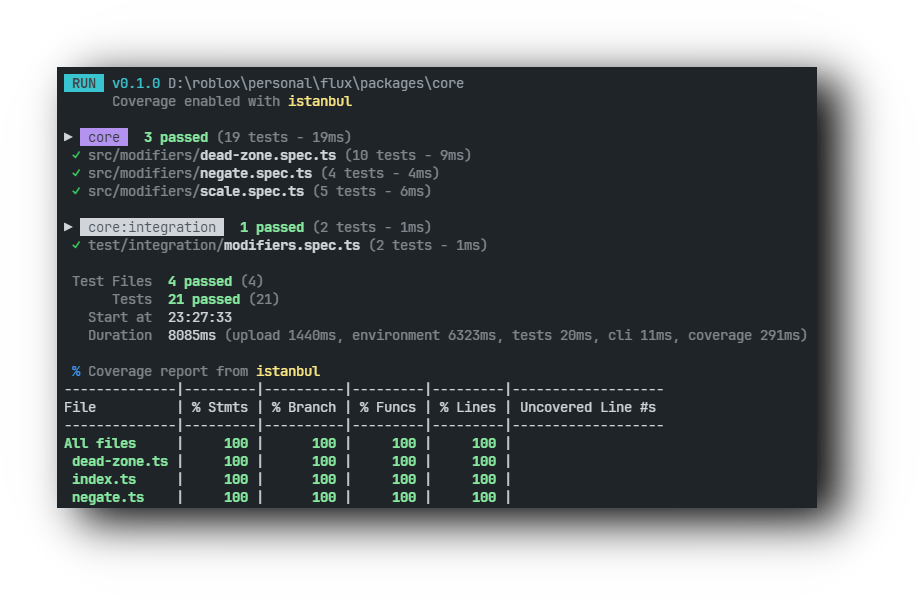

<h1 align="center">jest-roblox-cli</h1>

<div align="center">

[](https://npmx.dev/package/@isentinel/jest-roblox)
[](https://discord.com/channels/385151591524597761/1508303470627651694)
[](https://github.com/sponsors/christopher-buss)
[](#standalone-binary)

[](https://github.com/christopher-buss/jest-roblox-cli/actions/workflows/ci.yaml)
[](https://github.com/christopher-buss/jest-roblox-cli/blob/main/LICENSE)

</div>

`@isentinel/jest-roblox` is a package used to run roblox-ts and Luau tests
inside Roblox and get the results in your terminal.

<p align="center">
  
</p>

## Features

- Runs roblox-ts and pure Luau tests.
- Maps Luau errors back to the lines of your `.ts` files.
- Collects code coverage, with thresholds and Istanbul reporters.
- Runs on three backends: a hidden Studio it starts itself, Open Cloud, or a
  Studio you have open.
- Runs every package of a monorepo in one command.
- Runs only the tests that reach the files you changed.
- Runs TypeScript and Luau type tests on your machine.
- Prints results for people, for AI agents, as JSON, or as GitHub Actions
  annotations.
- Shows each step of a run as it happens, so a slow upload does not look stuck.

<!-- prettier-ignore -->
> [!NOTE]
> Source maps and coverage for roblox-ts projects need a compiler that writes
> `.luau.map` files:
> [sloptor](https://github.com/howmanyslop/sloptor) or
> [@isentinel/roblox-ts](https://npmx.dev/package/@isentinel/roblox-ts).

## Install

The npm package needs Node.js 26 or later.

```bash
npm install -D @isentinel/jest-roblox
```

A run also needs these tools:

- **Backend**: install Roblox Studio and log in, or get Open Cloud credentials
  (see [Backends](#backends)).
- **[rojo](https://rojo.space)** on your `PATH`: the `studio-cli` and
  `open-cloud` backends use it to build the place, and coverage uses it on every
  backend.
- **Jest Roblox** in your place: install `@rbxts/jest` (roblox-ts) or
  [`roblox/jest`](https://wally.run/package/roblox/jest) (Wally), and put it in
  your Rojo tree. The CLI finds it in `ReplicatedStorage`. Set `jestPath` when
  it is somewhere else.
- **[lute](https://github.com/luau-lang/lute)** 1.x on your `PATH`, only for
  Luau type tests and for a `jest.config.luau` that holds code.

### Type tests

Type tests need a TypeScript 7 checker. It is an optional peer dependency.
Install it only if you turn on type tests (`--typecheck`, `--typecheckOnly` or
`test.typecheck.enabled`):

```bash
npm install -D typescript@7
```

If [tsrs](https://github.com/oxc-project/tsrs) is installed, type tests use it
first. If your project keeps TypeScript 6 for other tools, install 7 beside it
as `@typescript/native`. Type tests use it before `typescript`:

```bash
npm install -D @typescript/native@npm:typescript@7
```

### Standalone binary

You can run the CLI without Node.js. Each
[GitHub release](https://github.com/christopher-buss/jest-roblox-cli/releases)
has binaries for Linux x64, macOS on Apple silicon and Windows x64. Install one
with mise or rokit:

```bash
mise use github:christopher-buss/jest-roblox-cli
rokit add christopher-buss/jest-roblox-cli
```

The binary has these limits:

- TypeScript type tests (`.spec-d.ts`) do not run.
- It cannot load a `.ts` config. Use `jest.config.luau`, `.json`, `.js` or
  `.mjs`.
- rojo must still be on your `PATH`.

## Quick start

Add a `jest.config.ts` to your project root:

```typescript
import { defineConfig } from "@isentinel/jest-roblox";

export default defineConfig({
	placeFile: "./game.rbxl",
	test: {
		projects: ["ReplicatedStorage/shared"],
	},
});
```

Then run:

```bash
npx jest-roblox
```

`projects` is optional. Without it, the CLI makes one project from the folders
your Rojo project mounts (or from tsconfig `outDir`). Set `projects` when you
need a separate `displayName`, `setupFiles` or `include` for each project.

## Usage

```bash
# Run all tests
jest-roblox

# Run some files (TypeScript or Luau)
jest-roblox src/player.spec.ts src/player.spec.luau

# Filter by test name or by file path
jest-roblox -t "should spawn"
jest-roblox --testPathPattern player

# Run only the tests that reach these source files
jest-roblox related src/util.luau

# Run only the tests that reach a file changed in git
jest-roblox --changed
jest-roblox --changed main

# Pick a backend
jest-roblox --backend open-cloud

# Collect coverage
jest-roblox --coverage

# Save print, warn and error output from the game to a file
jest-roblox --gameOutput game-logs.txt
```

Run `jest-roblox --help` for every flag.

Before a build, the CLI creates missing Rojo `$path` folders and checks the Rojo
project. If the project is not valid, the CLI prints
`Pre-flight validation failed:` and exits with code 2.

Each run writes what it printed to `.jest-roblox/last-run.log`. If you lose part
of the output, read that file instead of running the tests again.

`related` and `--changed` have rules for when they run every test. See
[partial runs](skills/jest-roblox-cli/references/partial-runs.md).

### Exit codes

| Code | Meaning                                                                        |
| ---- | ------------------------------------------------------------------------------ |
| `0`  | All tests passed                                                               |
| `1`  | A test failed, a project timed out, or coverage is below threshold             |
| `2`  | The run stopped on an error: the configuration, the place, or a backend failed |
| `3`  | Roblox failed to run the task; the report shows what to send Roblox            |

## Configuration

The CLI finds `jest.config.*` in any format that
[c12](https://github.com/unjs/c12) loads (`.ts`, `.js`, `.mjs`, `.cjs`, `.json`,
`.yaml`, `.toml`), and `jest.config.luau`. Keep one config file in a folder.

A config can extend a shared config:

```typescript
export default defineConfig({
	extends: "../../jest.shared.ts",
	test: {
		projects: ["ReplicatedStorage/shared"],
	},
});
```

CLI flags win over the config file. The config file wins over the config it
extends.

Root fields control the run: `backend`, `placeFile`, `timeout`, `formatters`.
Jest fields go under `test`: `testMatch`, `setupFiles`, `collectCoverage`. Each
field has a doc comment that your editor shows. For the list of fields, see
[configuration](skills/jest-roblox-cli/references/configuration.md).

A project in `projects` can be a DataModel path or an object made with
`defineProject`:

```typescript
import { defineConfig, defineProject } from "@isentinel/jest-roblox";

export default defineConfig({
	test: {
		projects: [
			defineProject({
				test: {
					displayName: { name: "client", color: "magenta" },
					include: ["**/*.spec.ts"],
					outDir: "out/src/client",
				},
			}),
		],
	},
});
```

Default test files are `*.spec` and `*.test` files with a `.ts`, `.tsx`, `.lua`
or `.luau` extension. Type tests are `*.spec-d` and `*.test-d` files with a
`.ts` or `.luau` extension. Type tests run only on your machine, never in
Roblox.

## Backends

The default backend, `auto`, uses `studio-cli` when Roblox Studio is installed.
Otherwise it uses `open-cloud`. The choice is made once: if a `studio-cli` run
fails, the CLI does not try Open Cloud.

| Backend      | How it runs                                                 | Coverage |
| ------------ | ----------------------------------------------------------- | -------- |
| `studio-cli` | Starts a hidden Studio, runs the tests, and closes it       | yes      |
| `open-cloud` | Uploads the place to Roblox and runs it as a Luau task      | yes      |
| `studio`     | Connects to a Studio you have open, through a Studio plugin | no       |

`open-cloud` reads these environment variables:

| Variable                    | Value                        |
| --------------------------- | ---------------------------- |
| `ROBLOX_OPEN_CLOUD_API_KEY` | Your Open Cloud API key      |
| `ROBLOX_UNIVERSE_ID`        | The universe to run tests in |
| `ROBLOX_PLACE_ID`           | The place to run tests in    |

Add `JEST_` to the start of a name (for example `JEST_ROBLOX_PLACE_ID`) to
override the value without the prefix.

`studio` needs the `JestRobloxRunner.rbxm` plugin in Studio.

For the API key scopes, CI setup, timeouts, plugin install and the experimental
VM parallelism, see [backends](skills/jest-roblox-cli/references/backends.md).

## Coverage

Turn on coverage with `--coverage` or `test.collectCoverage`. The CLI adds
probes to a copy of your compiled Luau, builds a separate place from it, and
maps the hit counts back to your source files.

Every file that `collectCoverageFrom` selects (by default, every file under your
compiled Luau folders) is in the report. A source file with no test shows 0% and
fails `coverageThreshold`. To leave out part of a file, put `-- cov ignore next`
(`// cov ignore next` in TypeScript) above a statement.

For `OUTPUT_SIZE_LIMIT_EXCEEDED` on Open Cloud and other details, see
[coverage](skills/jest-roblox-cli/references/coverage.md).

## Workspace mode

`--workspace` runs the tests of every package in a monorepo in one command. A
package joins the run when it has a `jest.config.*`. The CLI finds packages from
the pnpm workspace, or from a `workspace` block in a shared config.

```bash
jest-roblox --workspace
jest-roblox --workspace --packages @scope/pkg-a,@scope/pkg-b
jest-roblox --workspace --affected-since main
jest-roblox --workspace --bail
```

Each package reads most fields from its own config, and gets its own coverage
report and threshold. See
[workspace](skills/jest-roblox-cli/references/workspace.md).

## Luau

A Luau-only project can write `jest.config.luau`. A config that holds only
literal values is read without running it. A config that holds code runs with
[lute](https://github.com/luau-lang/lute). Run `jest-roblox setup` to get the
`Config` type for luau-lsp.

Luau type tests (`*.spec-d.luau`) run with `lute check`. The package also has a
Luau module of type assertions.

See [Luau](skills/jest-roblox-cli/references/luau.md).

## Programmatic API

The `@isentinel/jest-roblox/api` entry exports the function that the CLI uses to
run tests. `loadConfig` reads the same config files, and `runJestRobloxAsync`
takes the CLI options as an object:

```typescript
import { loadConfig, runJestRobloxAsync } from "@isentinel/jest-roblox/api";

const config = await loadConfig();
const result = await runJestRobloxAsync({
	cli: { collectCoverage: true },
	config,
});
```

It prints no report. Pass the result to `formatResult` or `formatJson` to render
it.

## Agent skill

The package ships an agent skill in
[`skills/jest-roblox-cli`](skills/jest-roblox-cli/SKILL.md). Inside an AI agent,
the default formatter is `agent`, which prints less text.

## Contributing

See [CONTRIBUTING.md](CONTRIBUTING.md).

## License

MIT
